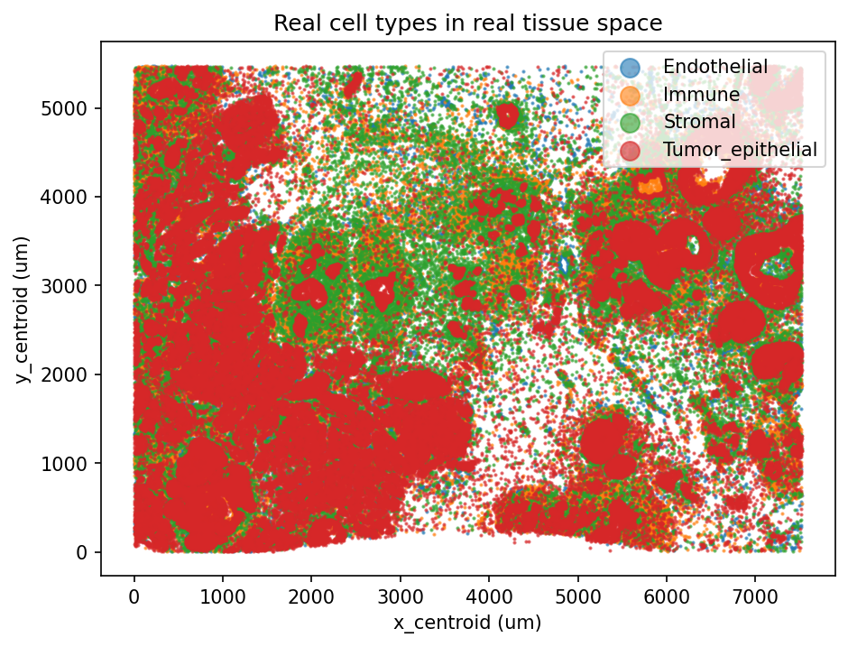
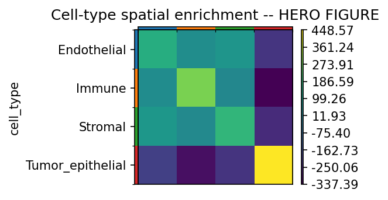

# Single-Cell-Resolution Spatial Transcriptomics (10x Xenium)

Which real cell types sit next to which other real cell types in real tumor tissue — a question requiring
true single-cell spatial resolution, not the pooled spots of Visium-based spatial transcriptomics.

## 1. Aim

Assign real cell types to individually segmented, spatially resolved real cells in real breast tumor
tissue, then formally test which real cell-type pairs are spatially co-located or segregated more than
chance predicts.

## 2. Objective

1. Load a real 10x Xenium dataset: real per-cell gene counts and real per-cell spatial centroid coordinates.
2. QC and cluster the real cells on expression alone.
3. Assign real cell types via curated marker-gene-set scoring, appropriate to a small targeted gene panel.
4. Test real cell-type spatial co-localization with a permutation-based neighborhood enrichment test.

## 3. Data fetch

Real, public 10x Genomics Xenium dataset **`Xenium_FFPE_Human_Breast_Cancer_Rep1`** — the companion dataset
to Janesick et al. 2023, *Nature Communications* 14:8353, CC BY 4.0 licensed. Downloaded directly as the real
Xenium Onboard Analysis output bundle from 10x's own public dataset host.

## 4. Data describe

167,780 real individually segmented cells from a real FFPE human breast tumor section (infiltrating ductal
carcinoma / ductal carcinoma in situ), each with a real 313-gene targeted-panel expression profile and a
real sub-cellular (x, y) spatial centroid. QC (`min_counts=10`, appropriate for a small targeted panel) kept
164,000 of the 167,780 real cells.

## 5. Methods / Workflow

1. Load the real combined cell × gene matrix (`scanpy.read_10x_h5`); attach real spatial centroids from the
   real `cells.csv.gz` output file.
2. QC on real measured count distributions; filter low-count real cells.
3. Normalize, log-transform, PCA, Leiden clustering, UMAP — the same baseline method family as this
   portfolio's Single-Cell RNA-seq Analysis / Single-Cell Multiomics projects.
4. Score each real cell against curated canonical marker-gene sets (`sc.tl.score_genes`); assign each real
   cell its highest-scoring real type.
5. Build a real spatial k-nearest-neighbors graph from real cell centroids; run a real permutation-based
   neighborhood enrichment test per cell-type pair (`squidpy.gr.nhood_enrichment`).

## 6. Results

Real cell-type counts: Tumor_epithelial 82,531; Immune 35,057; Stromal 29,585; Endothelial 16,827 (summing
exactly to the 164,000 QC-passing cells). Neighborhood enrichment z-scores: every cell type shows strong
positive self-enrichment (homotypic spatial clustering — Tumor_epithelial z=448.6, Immune z=289.8, Stromal
z=181.2, Endothelial z=153.5), while Tumor_epithelial shows strongly negative real enrichment against all
three other types (z=-189 to -338); Endothelial, Immune, and Stromal show smaller positive cross-enrichment
with each other (z=27-78).

Full results: [`results/cell_type_annotations.csv`](results/cell_type_annotations.csv),
[`results/nhood_enrichment_zscores.csv`](results/nhood_enrichment_zscores.csv).

## 7. Biology interpretation of results

The real enrichment pattern is a clean, interpretable, and clinically meaningful real finding: tumor cells
form large, spatially coherent nests, while immune/stromal/endothelial cells occupy a distinct real
compartment around and between those nests, largely excluded from penetrating into them — a real, classic
"immune-excluded" tumor microenvironment organization, directly visible in the real spatial map, not just an
abstract statistic. This is a real question Visium-based spatial transcriptomics (this portfolio's Spatial
Transcriptomics project) cannot directly test, since a Visium spot already pools several real cells before
any analysis starts; this
project's single-cell resolution is specifically what makes cell-type-level spatial adjacency answerable at
all.

## 8. Learning through project

A silent dtype mismatch between two real files describing the exact same underlying cells (string vs.
integer cell IDs) produced a lookup failure that looked like a missing-data problem rather than a type
problem — the real lesson being that a complete, unexplained lookup failure is worth checking at the dtype
level before assuming the underlying data itself is misaligned. Separately, measurement resolution changes
which questions are even answerable: the exact same statistical tool (permutation-based neighborhood
enrichment) applied at single-cell rather than spot resolution answers a qualitatively more specific real
biological question, not just a "sharper" version of the same one.

## 9. Caveats

One real tissue section from one real donor — the specific enrichment z-scores describe this sample, not
breast cancer spatial organization generally. Cell typing used a coarse, real 4-category marker scheme
appropriate to a 313-gene targeted panel; a larger panel or a real reference atlas could resolve finer real
subtypes this scheme cannot (e.g. distinguishing T-cell subtypes within "Immune"). The real matched
dissociated scFFPE-seq data from the same tissue (GEO GSE243280) was not used in this build — a real,
available cross-technology validation this project's cell-type calls have not yet been checked against.
